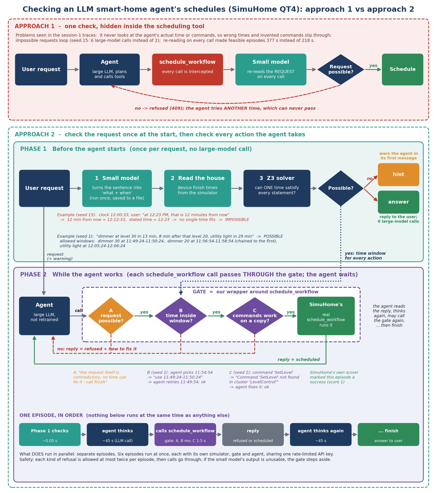

# Approach 2: check once at the start, then check the agent's plan

Second version of the SimuHome QT4 scheduling gate. Approach 1 lives untouched in
`../neuro_symbolic_scheduler`; this directory reuses its idea and trained parser but
changes where and what the gate checks. Target venue unchanged: IEEE IoT-J special
issue on small-large model collaboration (deadline 15 Dec 2026).



One request, step by step in time order: [docs/approach2_flowchart.png](docs/approach2_flowchart.png)

## What changed, in one paragraph

Session-1 traces showed the approach-1 gate re-parsed the request on every
`schedule_workflow` call, checked only the request (never the call), and answered
with a 409 the agent could not act on, so the agent kept retrying other times
(infeasible: 4.4 agent calls/episode vs 3.4 without the gate; feasible: 377 s vs
218 s per episode). Approach 2:

- **A. Pre-flight**: parse once, read device finish times from the simulator, run one
  joint Z3 system before the agent starts. A contradiction is either told to the agent
  at step 0 (`hint`) or answered directly with no agent call at all (`answer`).
- **B. Final rejection**: if the agent still schedules a contradictory request, the
  409 says no start time can fix it and to call `finish`.
- **C1. Time window**: for consistent requests, Z3 computes each goal's allowed start
  window (including chained goals such as "8 min after the previous action"), and the
  call's `start_time` must fall inside it.
- **C2. Dry run**: the steps run on a copy of the home moved to `start_time` (SimuHome's
  own initializer and fast-forward); steps that would fail are refused with SimuHome's
  error text, and target attributes that would not reach the requested value are flagged.
- **Parallel episodes**: N episodes at once, each with its own simulator, one throttled
  key, so a free 40 requests/min NVIDIA key is actually used.

Details and limits: [ARCHITECTURE.md](ARCHITECTURE.md). Latest experiment results and what they mean: [docs/FINDINGS.md](docs/FINDINGS.md).
New to the project? Start with
[docs/GUIDE.md](docs/GUIDE.md), which explains everything from the basics (episodes, seeds,
the data split, 5-fold, caveats).

## Status (11 Oct 2026)

Built and tested locally (no LLM, no GPU). **No E1 run with a real agent yet.**

| Check | Result |
|---|---|
| `tests/test_pipeline.py`: joint Z3 verdicts on ground-truth IR | 286/286 (as approach 1) |
| same: benchmark goal times inside the computed window | 301/301 |
| `tests/test_gate.py`: pre-flight verdicts with anchors read live from SimuHome | 286/286 |
| same: calls at the benchmark's own goal times refused | 0/301 |
| same: calls 5 min off refused (bounded windows) | 244/244 (+7 that hit another goal on the same device, correctly passed) |
| same: infeasible requests get the final rejection; caps fail open | 136/136; yes |
| same: dry run refuses invented commands, passes valid ones | yes |
| `tests/test_e2e_fake_llm.py`: real simulators + SimuHome runner and scorer, scripted agent, 2 episodes in parallel | v1_gate 4 agent calls/episode, pre_hint 1, answer 0; wrong time and invented command refused, corrected plan scores 1 |
| Z3 called from 8 threads at once (the parallel runner) | consistent with sequential results (Z3 is serialised behind a lock; without it Z3 crashed) |
| Notebook 00 executed top to bottom offline (fake OpenAI server, gold parse cache, 2 workers) | runs; all arms behave as designed |
| Notebook 01 non-GPU cells executed (label check, split) | 286/286, 301/301, split 221/25/54 |

The tests use the **gold** IR as a perfect parser. With the real parser the numbers
depend on parser accuracy, which notebook 01 measures (verdicts, window safety,
target accuracy).

## Layout

```
README.md, ARCHITECTURE.md
src/                         ir_schema.py (IR v3), constraint_encoder.py (joint Z3 + windows),
                             extract_ir_from_episode.py (v3 labels), gate.py (A, B, C1, C2),
                             shadow_sim.py (dry run), harness.py (patches SimuHome),
                             parallel_runner.py (N episodes at once)
tests/                       test_pipeline.py, test_gate.py, test_e2e_fake_llm.py, _paths.py
notebooks/01_train_parser_v3.ipynb   GPU (Kaggle T4 or the H100): v3 labels, LoRA, eval, parse cache
notebooks/00_approach2_pipeline.ipynb  E1; CPU-only when a parse cache is attached
scripts_build_notebooks.py   generates both notebooks from src/ (edit this, not the .ipynb)
docs/architecture_comparison.png, docs/make_figures.py
results/                     put downloaded result zips here
```

## Running locally (no GPU, no API key)

```bash
pip install z3-solver
python tests/test_pipeline.py ../SimuHome/data/benchmark
```

```bash
python tests/test_gate.py ../SimuHome
```

```bash
python tests/test_e2e_fake_llm.py ../SimuHome
```

```bash
python scripts_build_notebooks.py
```

`test_gate.py` and `test_e2e_fake_llm.py` need SimuHome's own dependencies installed
(`pip install -e ../SimuHome --ignore-requires-python`). The e2e test starts two local
simulator servers and takes about two minutes.

## Running the experiment

1. **Parser (once, GPU).** Send `notebooks/01_train_parser_v3.ipynb` to the H100 (or run
   it on a Kaggle T4). It returns `parser_v3_outputs.zip` with the v3 adapter,
   `parser_eval_v3.json` and `parse_cache_v3.json`. Why retrain: the v2 labels cannot say
   "after the previous action" (42/50 QT4-1 feasible requests) or "no later than" (all
   QT4-3), which C1 needs. Same model, recipe and split as v2. Training is small
   (221 examples, minutes on an H100).
2. **E1 (CPU is enough).** Upload `notebooks/00_approach2_pipeline.ipynb` to Kaggle,
   attach `parse_cache_v3.json` as a dataset, add the secret `NVIDIA_API_KEY`, Internet
   ON. Edit `PLAN` / `WORKERS` / `LLM_MODEL`, then *Save & Run All*. Download
   `approach2_results.zip`.
   - Without a v3 cache, the notebook can build a **v2** cache from the old adapter on a
     GPU session; then C1 is switched off automatically and A, B, C2 still run.
   - Several agent models: one notebook per model on the same key, with
     `NOTEBOOKS_SHARING_KEY` set to the number running at once.
