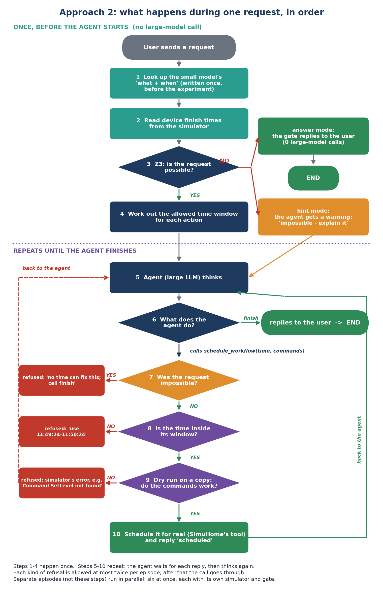

# The whole project, explained from the beginning

This guide assumes nothing. It explains what SimuHome is, what an "episode" and a
"seed" are, what problem we are solving, how approach 2 works step by step, why the
data is split the way it is, what "5-fold" means, and what can still go wrong.
Every number in it comes from the real benchmark files or from our own runs.

---

## 1. The big picture in one paragraph

People talk to smart-home assistants: *"Turn on the kitchen light when the dishwasher
finishes."* The assistant is a large language model (LLM) that calls tools to read and
control devices. Scheduling requests like this one are where these assistants fail most.
Our project puts a **checker** between the large model and the house: a small, cheap model
turns the request into a precise "what and when" description, a logic solver (Z3) checks
that description, and a copy of the house rehearses each scheduled action before it is
allowed to happen. The large model is never retrained. The goal is fewer mistakes, fewer
expensive large-model calls, and a result we can publish.

---

## 2. SimuHome: the simulator and the benchmark

**SimuHome** (ICLR 2026, arXiv 2509.24282) is two things:

1. **A simulator**: a virtual house in software. It has rooms, devices (lights, air
   conditioners, washers, dryers, dishwashers...) and room conditions (temperature,
   humidity, light level, air quality). Devices follow the Matter standard used by real
   smart-home products. Time moves in ticks of 0.1 seconds, and the simulator can jump
   ahead in time instantly ("fast-forward").
2. **A benchmark**: 600 test cases, called **episodes**, used to measure how good an
   assistant (an "agent") is.

**The agent** is an LLM running a loop called ReAct: it thinks, picks a tool, sees the
result, thinks again, and so on until it calls `finish` with an answer for the user.
The tools include:

| Tool | What it does |
|---|---|
| `get_room_devices` | list the devices in a room |
| `get_attribute` | read one value from a device (e.g. a washer's remaining time) |
| `execute_command` | do something now (e.g. turn a light on) |
| `schedule_workflow` | register commands to run at a future time |
| `finish` | stop and reply to the user |

---

## 3. What an "episode" is

An **episode** is one test case: one house, one user request, and the answer key. It is
one JSON file in `SimuHome/data/benchmark/`, for example `qt4-1_infeasible_seed_15.json`.

Each file contains:

| Part | What it is | Example |
|---|---|---|
| `query` | what the user says | "At 12:23 PM, that is 12 minutes from now, turn on light 1 in the living room..." |
| `initial_home_config` | the house at the start: rooms, devices, their settings, and the clock | clock = 12:00:33 |
| `eval.goals` | the answer key: which device must be in which state, and when | living-room light on |
| `eval.required_actions` | tools the agent must have called (so it cannot guess) | `get_room_devices(living_room)` |
| `temporal_conflict` | infeasible episodes only: the two times that contradict | 12:12:33 vs 12:23:33 |

### The 12 categories

SimuHome has six query types, each in a **feasible** version (the request can and should
be done) and an **infeasible** version (the request is impossible and the agent must say
why). That makes 12 categories of 50 episodes each = 600.

| Type | Meaning | Example |
|---|---|---|
| QT1 | ask about the house | "How humid is the kitchen?" |
| QT2 | implicit wish | "It feels sticky in here" -> lower the humidity |
| QT3 | explicit command | "Set the air purifier fan to 80%" |
| **QT4-1** | do something at a time | "Turn on the fan in 9 minutes" |
| **QT4-2** | do something when a device finishes | "20 min after the dishwasher finishes, turn on the light" |
| **QT4-3** | coordinate two devices | "Start the dryer now and pause it when the washer finishes" |

**Our work targets QT4 (scheduling), 300 episodes.** Section 13 explains why not QT2/QT3.

### A "cell"

A **cell** is one (sub-type, case) pair, for example "QT4-2 infeasible". QT4 has 6 cells
of 50 episodes. Results are reported per cell.

---

## 4. What a "seed" is (and why the numbers look odd)

SimuHome did not write its 600 episodes by hand. A program **generated** them: it built a
random house, picked random devices and goals, and had an LLM write the user's sentence.
"Random" in a computer program is controlled by a number called the **seed**. The same
seed always produces the same house and the same episode, which makes the benchmark
reproducible.

So the **seed is simply the episode's ID number within its category**. In the file name
`qt4-1_infeasible_seed_15.json`:

- `qt4-1` = sub-type, `infeasible` = case, `seed_15` = episode number 15 of that category.

Why the numbers are not always 1 to 50: the generator tried seeds in order, and some seeds
produced a house that did not fit the category (for example no running dishwasher to wait
for). Those were skipped. So QT4-1 has seeds 1-50, but QT4-2 has 50 episodes spread over
seeds 1-61, and QT4-3 over seeds 2-81.

**The seed has no meaning by itself.** It is a label. Seed 15 is not harder than seed 14.
That is exactly why we can use it to split the data fairly (section 9).

---

## 5. The problem we are solving

### 5.1 Scheduling is the hardest category

From the SimuHome paper (Table 1, success rates in %, feasible / infeasible):

| Agent | QT4-1 | QT4-2 | QT4-3 |
|---|---|---|---|
| GPT-4.1 | 50 / 12 | 46 / 34 | 34 / 32 |
| GPT-5.1 (a reasoning model, 3-5x slower) | 60 / 100 | 72 / 92 | 56 / 44 |

### 5.2 Two causes the paper identifies

1. **Contradiction blindness (infeasible episodes).** The user says two times that cannot
   both be true, and the agent does not notice. Example `qt4-1_infeasible_seed_15`: the
   clock says 12:00:33 and the user says "at 12:23 PM, that is 12 minutes from now". 12
   minutes from now is 12:12:33, not 12:23. A good assistant should point this out. For
   GPT-4.1 this is 85% of its infeasible scheduling errors.
2. **No feedback when scheduling (feasible episodes).** `schedule_workflow` accepts
   anything. It replies "registered" even if the time is wrong or a command does not exist;
   the mistake only shows up later, when the workflow runs, after the agent has finished.
   In the paper, for explicit commands (QT3) over 40% of successes came from the agent
   fixing an error it was told about. For scheduling it is never told, so it never fixes
   anything.

### 5.3 Why it matters for IoT

Reasoning models fix part of this but take over 100 seconds per request, which is too slow
for a home assistant. Our target venue (IEEE IoT Journal special issue on small-large model
collaboration, deadline 15 Dec 2026) asks exactly how small, cheap models can cooperate
with large ones and decide when the large one is needed.

---

## 6. Approach 1 (the first version) and what went wrong

Approach 1 put a checker inside `schedule_workflow`. Every time the agent tried to
schedule, a small model (Qwen3-1.7B, fine-tuned) read the user's request and Z3 checked
whether its times were consistent. If not, the tool refused with an error (code 409).

It worked for its main goal: on 10 QT4-1 infeasible episodes, success went from 3/10 to
10/10. But the traces showed three problems:

| Problem | Evidence |
|---|---|
| It checked the **request**, never the agent's actual call (time, commands) | could not catch wrong times or invented commands |
| The agent kept retrying with other times, which can never pass | infeasible: 4.4 large-model calls per episode instead of 3.4 |
| It re-ran the small model on every scheduling call | feasible: 377 s per episode instead of 218 s; success unchanged at 2/10 |

---

## 7. Approach 2: the pipeline, step by step



The steps happen one after another: the agent waits for every reply from the checker.
Only separate episodes run in parallel.

Follow one feasible request through it, `qt4-1_feasible_seed_1`:

> "Set dimmer light 1 in the living room to power on at level 30 at 13 minutes from now,
> and 8 minutes after the previous action drop it to level 20... Also turn on light 1 in
> the utility room at 29 minutes from now."

### Step 0 (once, before any evaluation): the small model

A small model (Qwen3-1.7B with LoRA, trained in notebook 01) turns the sentence into a
structured description, the **IR** (intermediate representation):

```
goal 0: living-room dimmer on, level 30   when: 13 min after now
goal 1: living-room dimmer on, level 20   when: 8 min after goal 0
goal 2: utility-room light on             when: 29 min after now
```

Because this output depends only on the sentence, we run the small model once for every
request and save the results in `parse_cache_v3.json`. The evaluation then needs no GPU.

### Step A: pre-flight check (before the large model starts)

1. Look up the IR for this request.
2. If a goal depends on a device finishing ("when the dishwasher finishes"), read that
   device's remaining time directly from the simulator. No large-model call is needed.
3. Give all the goals to **Z3**, a logic solver, as one system of equations over time.

Two outcomes:

- **Impossible (UNSAT).** Two statements give the same action two different times. Either
  - *hint mode*: add a note to the agent's first message ("this request contains a timing
    contradiction: ... do not schedule; explain it to the user"), or
  - *answer mode*: reply to the user directly with the explanation and **never call the
    large model** at all.
- **Possible (SAT).** Z3 also computes, for each goal, the **time window** in which it may
  start. Here: goal 0 between 12.5 and 13.5 min, goal 1 between 20 and 22 min, goal 2
  between 28.5 and 29.5 min. Goal 1's window comes from chaining it to goal 0, which is
  why this needs a solver and not a single subtraction.

### Step B: final rejection

If the request is impossible and the agent still calls `schedule_workflow`, the reply says
the contradiction is in the request itself, so no other time can fix it, and that the
agent should call `finish`. This stops the retry loop from approach 1.

### Step C: checking each scheduling call (for possible requests)

- **C1, time window.** The call's start time must fall inside the window of the goal whose
  devices it touches. If the agent schedules the dimmer at 18 minutes, it is refused with
  "for living_room_dimmable_light_1 the request works out to between 11:49:24 and 11:50:24".
- **C2, dry run.** A copy of the house is built from the current state, moved forward to
  the start time, and the commands are run on the copy. If a command would fail, the call
  is refused with the simulator's own message, for example
  *"Command 'SetLevel' not found in cluster 'LevelControl'"*. If the commands run but the
  device would not end up in the requested state, a warning is attached.
- **Limits.** Each kind of refusal can happen at most twice per episode; after that calls
  go through. So the checker can slow the agent down but never trap it.

### Parallel episodes

Several episodes run at the same time, each with its own simulator, all sharing one API
key under a single rate limit. Approach 1 ran one at a time and used under 2 of the 40
requests per minute the free NVIDIA key allows.

### The three models involved (don't mix them up)

| Role | Model | Trained by us? |
|---|---|---|
| Agent (does the task) | a large hosted model, e.g. Gemma-31B on NVIDIA's free API | no |
| Judge (scores infeasible episodes by reading the agent's answer) | a hosted model, asked 3 times | no |
| Parser (writes the IR) | Qwen3-1.7B + LoRA | **yes, the only one** |

---

## 8. How the small model learns, and what "training data" is here

The small model needs examples: (sentence, correct IR) pairs. We do not write these by
hand. Every episode already contains the answer key (`eval.goals`, and `temporal_conflict`
for infeasible ones), and `src/extract_ir_from_episode.py` converts that answer key into
the correct IR automatically. So **each of the 300 QT4 episodes gives one training example.**

Version 3 of these labels (approach 2) adds two things version 2 could not express:
"8 minutes after the previous action" (42 of 50 QT4-1 feasible requests) and "no later
than" (all QT4-3 requests). That is why the parser is retrained in notebook 01.

---

## 9. Why the data must be split, and how the seed is used for it

### 9.1 The exam analogy

If a student studies the exact questions that will be on the exam, a perfect score proves
nothing. A model is the same: **if we test it on episodes it was trained on, the result is
meaningless.** Reviewers call this *data leakage* and reject papers for it.

So the 300 QT4 episodes are divided:

- **training set**: the model learns from these;
- **validation set**: a small slice used only to watch training progress;
- **test set** (held-out): never seen during training; all reported results come from it.

### 9.2 Why we split by seed

We need a rule that is fixed, reproducible, and has nothing to do with difficulty. The
seed is perfect for that, because it is just a label. The rule is:

> **An episode is in the test set if its seed is divisible by 5** (seed 5, 10, 15, ...).
> All others are training (90%) or validation (10%).

"Divisible by 5" is written `seed % 5 == 0` in code (`%` gives the remainder of a
division). It picks about 1 in 5 episodes from every cell. Resulting test set:

| Cell | Test seeds | Count |
|---|---|---|
| QT4-1 feasible | 5, 10, 15, 20, 25, 30, 35, 40, 45, 50 | 10 |
| QT4-1 infeasible | 5, 10, ..., 50 | 10 |
| QT4-2 feasible | 15, 20, 30, 35, 45, 50, 55, 60 | 8 |
| QT4-2 infeasible | 15, 20, 30, 35, 45, 50, 55, 60 | 8 |
| QT4-3 feasible | 20, 30, 35, 45, 50, 55, 70, 75, 80 | 9 |
| QT4-3 infeasible | 20, 30, 35, 45, 50, 55, 60, 70, 75 | 9 |
| **Total** | | **54** |

The other 246 episodes become 221 training and 25 validation examples. Approach 1 used
exactly this split, so its results and approach 2's are comparable. The notebook also
checks that no test sentence appears in the training set.

---

## 10. Why 10 test episodes per cell can be a problem

### 10.1 Small samples are noisy

If you flip a fair coin 10 times you might easily get 7 heads. Ten episodes per cell is
like that: if the true success rate is 50%, ten episodes can easily show 30% or 70%.
Statistically, a success rate measured on 10 episodes is only known to about **±30
percentage points**; on 50 episodes, to about ±14.

### 10.2 What counts when comparing two methods

We run the agent with and without the checker on the same episodes. Episodes that pass or
fail in both tell us nothing. What matters is how many **flip** from fail to pass (or the
reverse). A standard test (McNemar) says: with all flips in one direction, you need at
least **6 flips** before the improvement is unlikely to be luck (p < 0.05).

| Claim | Expected size | Enough with ~10 per cell? |
|---|---|---|
| Contradictions get caught (infeasible) | large: approach 1 already flipped 7 of 10 | yes |
| Fewer large-model calls and seconds per episode | large and steady | yes |
| Higher success on feasible requests (C1 + C2) | probably modest, maybe 1-2 flips per cell | **no** |
| "Helps QT4-3 most" (per-sub-type claims) | varies | weak |

The feasible improvement is the newest part of approach 2, and it is the one 10 episodes
cannot prove.

---

## 11. The 5-fold option

### 11.1 The idea

We cannot get more episodes (the benchmark has 50 per cell), and we cannot test on
training episodes. **5-fold cross-validation** solves this by training five small models
instead of one, each with a different fifth held out.

Group the episodes by the remainder of their seed divided by 5:

| Group | Seeds | Size |
|---|---|---|
| 0 | 5, 10, 15, ... (remainder 0) | ~10 per cell |
| 1 | 1, 6, 11, ... (remainder 1) | ~10 per cell |
| 2 | 2, 7, 12, ... | ~10 per cell |
| 3 | 3, 8, 13, ... | ~10 per cell |
| 4 | 4, 9, 14, ... | ~10 per cell |

| Model | Trained on | Writes the IR for (never seen) |
|---|---|---|
| fold 0 | groups 1-4 | group 0 <- **the current notebook-01 run** |
| fold 1 | groups 0, 2, 3, 4 | group 1 |
| fold 2 | groups 0, 1, 3, 4 | group 2 |
| fold 3 | groups 0, 1, 2, 4 | group 3 |
| fold 4 | groups 0, 1, 2, 3 | group 4 |

Combine the five outputs into one cache. Now **every one of the 300 episodes has an IR
written by a model that never saw it**, so the evaluation can use all 50 per cell.

### 11.2 Benefits and costs

- 50 instead of ~10 test episodes per cell: uncertainty drops from about ±30 to ±14 points.
- Parser accuracy is reported as an average over five models, which reviewers trust more.
- Each model trains on about 240 examples, similar to now, with the same settings.
- Cost: four more trainings, about 2-3 hours on a Kaggle T4 (under an hour on an H100).
  The current run already is fold 0, so nothing is wasted.
- Rules: the same settings for all five folds, decided before running; no per-fold tuning.

### 11.3 Is it required?

**No, not always.** It is needed only for claims that 10 episodes cannot support (the
feasible improvement and per-sub-type claims). The plan:

1. Run the evaluation on the 54 test episodes first.
2. If the feasible improvement is clearly zero or negative, more episodes will not change
   that: skip 5-fold.
3. If it looks real but small, run 5-fold to confirm it with 50 episodes per cell.

Two other options exist: report pooled results over all 54 test episodes (free, but no
per-cell claims), or train on newly generated episodes and test on all 300 real ones
(cleanest, but needs ~1,000 LLM calls to write new sentences and careful checking).

---

## 12. What the paper can claim, and the experiment arms

Each "arm" is one version of the system, run on the same episodes:

| Arm | What it is |
|---|---|
| `baseline` | the agent alone |
| `selfcheck` | the agent told in its prompt to check the times itself (no solver) |
| `v1_gate` | approach 1, rebuilt in the same harness |
| `pre_hint` | pre-flight check; the agent gets a note when the request is impossible |
| `pre_answer` | pre-flight check; the checker answers impossible requests itself |
| `full` | `pre_hint` + time window (C1) + dry run (C2) |
| `full_answer` | `pre_answer` + C1 + C2 |

For each we report success rate, how often a correct request was wrongly refused, large-
model calls per episode, and seconds per episode. The intended claims:

1. A small model plus a solver catches timing contradictions before the large model acts.
2. Checking the agent's actual plan (window + dry run) catches mistakes the scheduling tool
   hides, which the SimuHome paper names as the main reason scheduling fails.
3. It saves large-model calls (answer mode: zero for impossible requests), which matches
   the special issue's theme.

Planned extra arm (reviewers will ask): the dry run offered as an *optional tool* the agent
may call. Recent work (arXiv 2601.03905) found agents use such optional simulators under 1%
of the time, which would support making the check automatic.

---

## 13. Why not QT2 and QT3 (checked on the data)

- **QT3 infeasible:** in all 50 episodes, every device the user names does not exist. A
  simple device lookup solves it, and strong models already score about 90%. No real
  research contribution is left.
- **QT2:** SimuHome decides which QT2 goals are possible with **hand-written rules**, not
  with its simulator. We tested a general simulation search: it agrees on 137 of 150 goals,
  but at least 9 of the 50 QT2-infeasible episodes contain a goal labelled impossible that
  SimuHome's own simulator can achieve (turning off a running fan raises the temperature;
  an air conditioner in heating mode warms the room). A simulation-based checker would be
  scored wrong there, and copying the rules would mean copying the answer key.

This mismatch can be reported in the paper as a short, verified note on benchmark validity.

---

## 14. Caveats (what can still go wrong)

1. **No real-agent results for approach 2 yet.** Everything so far is from tests that use
   the correct answers instead of the small model and a scripted agent.
2. **Everything depends on the small model's accuracy.** If it writes a wrong IR, the
   checker can refuse a correct schedule (limited to two refusals, but still a failure).
   Check `parser_eval_v3.json`: verdict accuracy (v2 was 91%), "window-safe goals" (should
   be near 100%), and target accuracy (v2 was 20/54 exact).
3. **Answer mode cannot undo a mistake.** If the small model wrongly calls a valid request
   impossible, that episode fails. Report hint and answer mode side by side.
4. **Perfect copy of the house.** The dry run uses the same simulator that scores the
   result. In a real home the copy would be approximate (see SimVerity, arXiv 2608.25067).
5. **The judge.** Infeasible episodes are scored by an LLM. Use the same, separate judge
   model for every arm and check about 30 of its decisions by hand.
6. **Reworded requests.** The benchmark's sentences come from templates; test whether the
   small model still works when an LLM rewords them.
7. **Free models can disappear.** Record model IDs and dates; run 2-3 agent models.
8. **Prior work to cite and distinguish:** Agent-C (logic checks on tool calls), AgentSpec
   and CARE (checking actions before they run), HomeFlow (turning intents into checkable
   conditions, used for training), MCP-Cosmos (planning with a simulator).
9. **Licence.** SimuHome may not be redistributed in modified form; we only patch it at
   runtime and publish our own code.
10. **Timeline.** One month gives results and a preprint; the journal decision comes in 2027.

---

## 15. How to run it

1. **Notebook 01** (`notebooks/01_train_parser_v3.ipynb`), Kaggle GPU T4 x2, Internet on,
   no secrets. Trains the small model, evaluates it, writes `parse_cache_v3.json`, and zips
   everything as `parser_v3_outputs.zip`. About 1-2 hours. Turn its output into a Kaggle
   Dataset.
2. **Notebook 00** (`notebooks/00_approach2_pipeline.ipynb`), CPU is enough, Internet on,
   secret `NVIDIA_API_KEY`, attach the dataset from step 1. Edit only `PLAN` (which cells
   and arms to run), `WORKERS` and `LLM_MODEL`. Results come out as `approach2_results.zip`.

---

## 16. Glossary

| Term | Meaning |
|---|---|
| Agent | the large model doing the task through tools |
| Arm | one version of the system in an experiment |
| Cell | one (sub-type, feasible/infeasible) pair, 50 episodes |
| Data leakage | testing on data the model learned from; makes results meaningless |
| Dry run | rehearsing commands on a copy of the house before allowing them |
| Episode | one test case: house + request + answer key |
| Feasible / infeasible | the request can be done / is impossible and must be explained |
| Fold | one of the five train/test arrangements in cross-validation |
| Held-out / test set | episodes never used for training; results come from these |
| IR | the small model's structured "what and when" description of a request |
| LoRA | a cheap way to fine-tune a model by training a small add-on |
| McNemar test | statistical test for paired before/after results; counts flips |
| Seed | the number that generated an episode; used as its ID |
| `seed % 5` | remainder of the seed divided by 5; 0 means "in the test set" |
| UNSAT / SAT | Z3's answer: no consistent time exists / one does |
| Z3 | a logic solver that checks whether a set of constraints can all be true |
